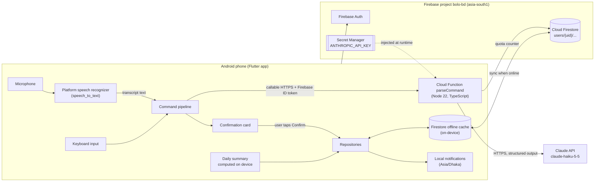

# 4. System architecture

## 4.1 The big picture



### What runs where, and why

| Component | Where | Why there |
|---|---|---|
| Speech-to-text | **Phone** (platform recognizer) | Free, low latency, and Bolo never handles raw audio. Cloud STT can replace it later (see [08](08-stt-evaluation-plan.md)). |
| Intent + field extraction | **Cloud Function → Claude API** | The API key must never be inside the app (an APK can be decompiled in minutes). The server also enforces quotas and validates output. |
| Database writes | **Phone → Firestore** (after the user confirms) | Works offline (writes are queued). Security rules check each write. The AI never writes directly. |
| Reminders / notifications | **Phone** (local notifications) | Fire without internet, and need no push server, no FCM, and no cost. |
| Daily summary | **Phone** | Simple arithmetic over the user's own records, so no AI call is needed. |
| Date/time resolution | Prompt context + server validation + **phone** final conversion | Each layer checks the previous one (see [03 § Ambiguous dates](03-feature-specifications.md#ambiguous-dates-and-times)). |

## 4.2 Request lifecycle: "kal sokal 10 tay rent dite hobe"

1. **Capture.** `SpeechService.listen(locale: 'bn-BD')` streams partial results and the sound level (which drives the orb).
2. **Normalise (phone).** The text is trimmed, capped at 500 characters, and checked against the inbox: if offline, it goes to the Inbox and stops here.
3. **Call.** `FirebaseFunctions.instanceFor(region: 'asia-south1').httpsCallable('parseCommand')`. The Firebase SDK automatically attaches the user's ID token (and an App Check token once that is enabled).
4. **Server checks.**
   1. Is the caller authenticated?
   2. Is the text length ≤ 500?
   3. Is the per-user daily quota (a Firestore transaction on `usage/{uid}`) not exceeded?
5. **AI call.** `client.messages.parse({ model: 'claude-haiku-5-5', output_config: { effort: 'low', format: zodOutputFormat(Schema) } })`. The system prompt is fixed, and the variable parts (today's Dhaka date, the calendar table, the user's text) go in the user message.
6. **Server validation.** The Zod schema is checked, dates are verified to be real and in range, amounts must be > 0 and < 10⁹, and the `stop_reason` is checked (`refusal`/`max_tokens` → `unknown`).
7. **Response → card (phone).** The response is decoded into a Dart `ParsedCommand`, checked again on the app side, and the card is rendered.
8. **Confirm → write.** The repository writes to Firestore (cache first, server when online) and, for reminders, schedules a local notification.

Latency budget (p50, 4G): STT end-of-speech ~1.0 s, function cold start 0–1.5 s (warm ~50 ms), Claude Haiku ~0.6–1.2 s, network ~0.3 s. Real numbers must be measured in Milestone 3.

## 4.3 Why Firestore offline instead of a separate local DB

> **Superseded (2026-11-27) by [ADR-10](adr/0010-drift-local-first.md):** Drift/SQLite is the local source of truth, with explicit Firestore sync for registered users only. This section is kept as the historical reasoning. See [docs/13](13-phase0-guest-data-audit.md).

The brief suggested "a local database". For the MVP, the recommendation is to **use Firestore's built-in offline persistence as that local database** instead of adding SQLite/Drift with a hand-written sync layer:

| | Firestore offline cache (chosen) | SQLite/Drift + custom sync |
|---|---|---|
| Offline read/write | ✅ built in, on by default on Android | ✅ |
| Sync & conflict handling | ✅ done by Google (last write wins per field) | ❌ you write it: queues, retries, conflicts, deletions. This is the #1 source of bugs in beginner apps |
| Security | Same rules for cache and server | Need both local and server rules |
| Code size | Small | Large |
| Weaknesses | A fresh install offline has an empty cache; complex queries are limited; the cache is per signed-in user | More control and full SQL |

The **repository pattern** (UI → `RemindersRepository` interface → `FirestoreRemindersRepository`) keeps this decision reversible. Swapping to Drift later means writing a new implementation, not rewriting screens.

## 4.4 Flutter app layers

```
UI (widgets/screens)            ← only displays state, calls controllers
   ↓
Controllers (Riverpod providers)← state + use-cases (e.g. CommandController)
   ↓
Repositories (interfaces)       ← "what" (saveExpense, watchToday)
   ↓
Data sources (Firestore, Functions, speech_to_text, notifications) ← "how"
```

- **State management: Riverpod.** It is testable (providers can be overridden with fakes in tests), compile-safe, and needs no `BuildContext` in logic. It is used without code generation to keep the toolchain simple for beginners.
- **Models** are plain immutable Dart classes with `toMap`/`fromMap`, with no code generation. That is easier to read and debug while learning.

## 4.5 Backend (Cloud Functions)

| Function | Type | Purpose | Status |
|---|---|---|---|
| `parseCommand` | Callable (HTTPS), `asia-south1`, 256 MiB, max 10 instances, timeout 20 s | Text → structured command | MVP |
| `deleteMyData` | Callable | Delete all of the user's data plus the Auth account | Before launch |

- **Runtime:** Node.js 22, TypeScript, `firebase-functions` v2 API, the official `@anthropic-ai/sdk`, and `zod`.
- **Secrets:** `defineSecret('ANTHROPIC_API_KEY')`, which is stored in Google Secret Manager and injected only into functions that declare it.
- **Region `asia-south1` (Mumbai)** is the closest Google region to Dhaka and matches the Firestore location already chosen for `bolo-bd`.
- **`maxInstances: 10`** is a cost safety valve: a traffic spike or attack cannot scale the function to hundreds of instances.

## 4.6 Environments

> **Corrected (2026-11-27) by [ADR-12](adr/0012-firebase-environments.md):** `bolo-bd` is the **development** project. Production (`bolo-prod`) is deferred to M6. The table below is historical.

| Env | Firebase | AI | Who |
|---|---|---|---|
| Local | Firebase **Emulator Suite** (Auth, Firestore, Functions) | Real API with a dev key, or a `MOCK_AI=true` stub returning canned JSON | Developers |
| Production | `bolo-bd` | Production key, quotas on | Users |

A separate `bolo-dev` project is recommended once there are real users, so that tests can never touch production data.

## 4.7 Key architectural decisions (ADR summary)

| # | Decision | Alternatives considered | Reason |
|---|---|---|---|
| ADR-1 | Flutter, Android first | Native Kotlin | The team already knows Flutter. One codebase keeps iOS possible later. |
| ADR-2 | Platform STT via `speech_to_text` for the MVP | Google Cloud STT, Whisper-style models | Zero cost, no audio handling. Must be validated by the evaluation in [08](08-stt-evaluation-plan.md). |
| ADR-3 | Claude Haiku 5.5 with structured outputs via Cloud Functions | Rule-based only, other LLMs | Good with Bangla and code-mixed text. Schema-constrained JSON. Very low per-token price. |
| ADR-4 | AI proposes, user confirms, client writes | AI writes directly | Safety for financial data. The user stays in control. |
| ADR-5 | ~~Firestore offline persistence as the local DB~~ **Superseded by [ADR-10](adr/0010-drift-local-first.md)** | Drift + custom sync | Much less code and fewer bugs. Reversible thanks to repositories. |
| ADR-6 | Local notifications for reminders | FCM push from the server | Work offline, no server cost, simpler. |
| ADR-7 | Anonymous auth, then email linking. **Data ownership superseded by [ADR-11](adr/0011-guest-data-local-only.md)** (guest data is local-only) | Mandatory signup | Zero-friction onboarding while keeping per-user isolation from the first second. |
| ADR-8 | Money as integer poisha | double | Exact arithmetic. |
| ADR-9 | "3D" = a GPU fragment-shader orb plus depth/parallax UI | Full 3D engine / models | Runs on low-end phones, has a small APK impact, and an accessible fallback. |
| ADR-10..12 | See [docs/adr](adr/README.md) | | |
