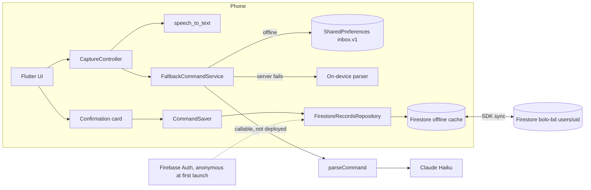
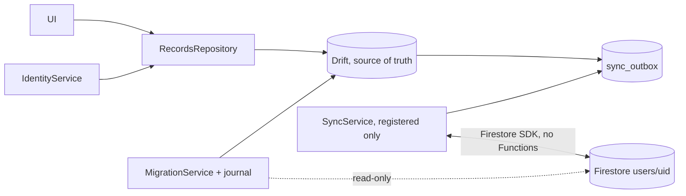
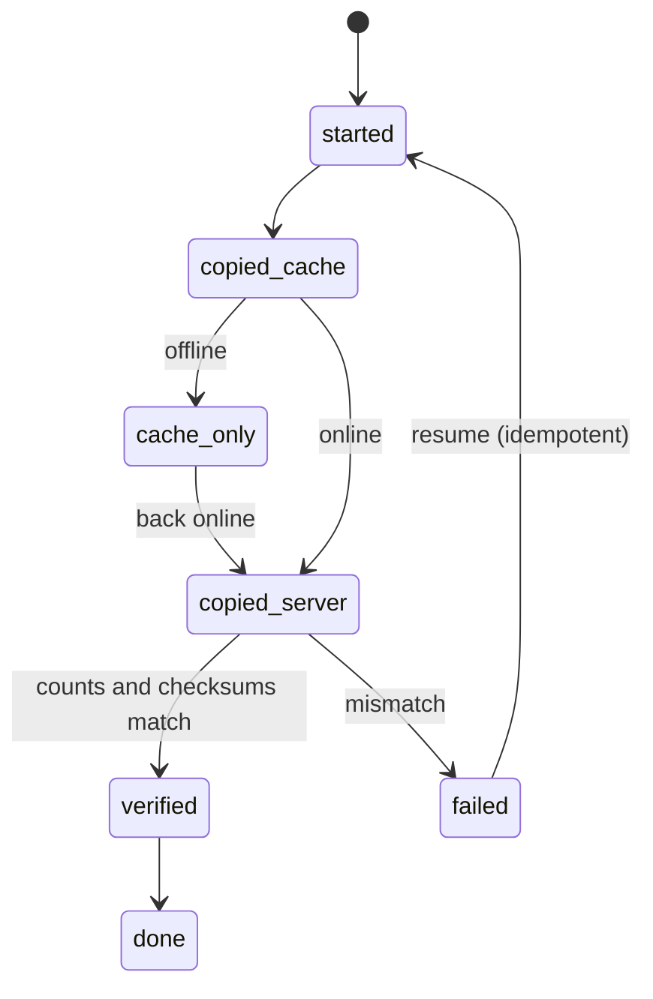

# 13. Phase 0 audit: guest data architecture and migration design

- **Date:** 2026-11-27 · **Code audited:** `main` @ `b6b82f5` (plus the voice/icon work committed alongside this doc)
- **Mode:** read-only. No Firebase data, rules, auth settings or billing were touched. **Live Firebase data was not inspected** (see § 6).
- **Decisions taken from it:** [ADR-10](adr/0010-drift-local-first.md), [ADR-11](adr/0011-guest-data-local-only.md), [ADR-12](adr/0012-firebase-environments.md). Open questions: [docs/11 § 11.4](11-risks-and-open-decisions.md).

Labels: **[C]** confirmed in code/config · **[L]** likely · **[U]** unknown · **[D]** needs a founder decision.

## 1. Summary

Bolo has no local database. Every personal record (reminders, tasks, expenses, ledger) is a Firestore
document under `users/{uid}`, and the "offline database" is Firestore's cache (ADR-5). Guests are
anonymous Firebase users, so **guest records are stored in Firestore** and depend on an anonymous
identity that is lost on reinstall or data clear. This contradicts the guest policy now recorded in ADR-11.

The fix needs no Cloud Functions and no Blaze: Drift on the phone, separated identities, a journaled
copy of existing records, and only then stricter rules.

**Ordering trap:** tightening the rules first, or letting a guest sign into an existing account first,
would permanently cut existing guests off from their data. Migration must ship and be adopted first.

## 2. Repository baseline

| Item | Value | |
|---|---|---|
| Flutter pinned by CI | **3.47.7** (`.github/workflows/ci.yml`): use this version | C |
| Android Gradle Plugin / Gradle / Kotlin plugin | 9.1.0 / 9.3.1 / 2.4.0 | C |
| Java | 21 (CI and builds) | C |
| compileSdk / minSdk | 37 / 24 | C |
| Backend | Node 22, firebase-functions 7.4, Anthropic SDK; `.firebaserc` default `bolo-bd` | C |
| Local DB / Google / Apple sign-in libraries | none in `pubspec.yaml` | C |
| Secrets in git | none (`google-services.json` is public client config; `docs/12` has a placeholder key only) | C |

Flutter 3.50+ requires Android Gradle Plugin ≥ 9.1.1 and Kotlin plugin ≥ 2.4.10 (`android.builtInKotlin=false`)
and rewrites `pubspec.lock`. Upgrade deliberately in one reviewed change (risk R14).

## 3. Current architecture



## 4. Authentication findings

| # | Finding | Evidence | Risk | |
|---|---|---|---|---|
| A1 | First launch blocks until anonymous sign-in succeeds | `app/lib/app.dart` `_signIn`, `build` | High | C |
| A2 | Records need a uid; no uid → no repository | `app/lib/core/providers.dart` | High | C |
| A3 | Google/Apple sign-in not implemented | `pubspec.yaml` | – | C |
| A4 | Email linking keeps the same uid | `auth_service.dart` `linkEmail` | – | C |
| A5 | No UI to sign in to an existing account (new phone impossible) | `signInWithEmail` unused | High | C |
| A6 | No sign-out UI, no account deletion | grep; docs/06 (M6) | Medium | C |

Identity situations today: (1) valid anonymous session works; (2) lost anonymous identity → new uid, old
data unreachable; (3) linked credential keeps uid and data; (4) existing-account sign-in has no UI and would
orphan guest data; (5) registered user on a new phone cannot sign in; (6) temporary offline works from the
cache once signed in. Target: device / session / account identities (ADR-11).

## 5. Data persistence findings

| Entity | Storage today | Key / owner | Delete | |
|---|---|---|---|---|
| Reminders, tasks, expenses, ledger | Firestore `users/{uid}/…` + cache; server `createdAt`/`updatedAt`, `schemaVersion` 1 | auto-id / uid path | hard delete | C |
| Debt repayments | not modelled (settle = status flip) | – | – | C |
| Notes, lists, chat, memory | do not exist | – | – | C |
| Offline inbox | SharedPreferences `inbox.v1`, plain JSON, ≤ 20 | device | on process | C |
| Settings | SharedPreferences `settings.*`, `assistant.*` | device | – | C |
| Notification ids | FNV-1a hash of record id; re-scheduled at launch (adds only) | – | cancel on done | C |
| Transcripts | not written by the app (rules would allow ≤ 500 chars) | – | – | C |
| AI usage | `usage/{uid}`, server only | – | – | C |

Also: writes are fire-and-forget, and a rejected write is only `debugPrint`ed [C]. Models import Firestore `Timestamp` [C].
`allowBackup="false"` [C], so local data has no Android backup.

## 6. Firestore guest data

- [C] Every guest record is written to Firestore under the anonymous uid; anonymous and registered users share collections; rules do not distinguish them.
- [U] Counts of anonymous accounts and affected documents. **Not inspected.** Safe ways to check, with approval:
  1. Firebase Console → Authentication (user count and provider per user, no export).
  2. A reviewed, read-only Admin SDK script using `count()` aggregation per `users/{uid}/{collection}`, printing totals only (≈ 1 read per 1,000 docs).
- Risks of leaving it: unrecoverable personal financial data accumulating (cleanup disabled), data loss on every reinstall, read costs growing with guests.

## 7. Security

| Check | Status | |
|---|---|---|
| Owner-only access, cross-user isolation | yes, tested in `functions/test/rules.test.ts` | C |
| Anonymous vs registered | **not distinguished** | C, Critical |
| Default deny; `usage` server-only; strict field validation | yes | C |
| Subscription/entitlement data | none yet | C |
| App Check | off (`ENFORCE_APP_CHECK = false`) | C |

Target rules (concept, not deployed):

```
registered() = auth != null && auth.token.firebase.sign_in_provider != 'anonymous'
users/{uid}/{records}/{id}:
  read:   isOwner(uid) && (registered() || transitionalAnonRead())   // grace period only
  write:  isOwner(uid) && registered() && valid(...)                 // + sync fields
  delete: false                                                      // soft delete via tombstones
entitlements/{uid}: owner read-only; usage/{uid}: no client access; everything else: deny
```

## 8. Data-loss risks

| # | Risk | | Level |
|---|---|---|---|
| L1 | Reinstall / data clear → new anonymous uid → earlier records unreachable | C | Critical |
| L2 | No way back into a linked account on a new phone | C | High |
| L3 | Rejected write silently rolled back | C (mechanism) | Medium |
| L4 | Rules tightened before migration → guest data unreadable | C (by design) | Critical if mis-ordered |
| L5 | Existing-account sign-in before migration replaces the anonymous session | C | Critical if mis-ordered |
| L6 | Local guest store has no backup | C | Medium [D] |
| L7 | Inbox text in plain SharedPreferences | C | Low |

## 9. Drift target

- **Tables:** `reminders`, `tasks`, `expenses`, `ledger_entries`, `ledger_payments`, `inbox_items`, `app_meta`, `migration_runs`, `migration_items`, `sync_outbox`, `sync_state`. Non-personal UI settings stay in SharedPreferences.
- **Record columns:** see [ADR-10](adr/0010-drift-local-first.md).
- **Indexes:** `(owner_scope, deleted_at, status)`, `(owner_scope, remind_at)`, `(owner_scope, spent_at)`, `(sync_state)`.
- **Transactions:** record + outbox row in one transaction.
- **Schema:** Drift `schemaVersion` + `MigrationStrategy`, a migration test per version.
- **Repository:** keep `RecordsRepository`; add `DriftRecordsRepository`; sync is a separate service reading the outbox.
- **Corruption:** guarded open → recovery screen, keep the file, offer export; never auto-wipe.

## 10. Registered-user sync



- **Push:** outbox rows with `op_id`; `set(merge)` to a fixed doc id (idempotent); exponential backoff with jitter; permanent rejections → `conflict`, kept locally, shown to the user.
- **Pull:** per collection, `serverUpdatedAt > cursor`; first sync on a new device = paged full pull.
- **Conflicts:** last server write wins for reminders/tasks; financial records changed on two devices → keep both, ask the user [D].
- **Deletes:** tombstones (`deletedAt`), purged after N days [D].
- **Account switch:** data stays separated by `owner_scope`; on sign-out ask whether to remove that account's local copy [D].
- Guest data never syncs. Importing guest data, financial conflicts and removing an account's local copy always need the user.

## 11. Guest migration: six scenarios

**Mechanism:** a `migration_runs` journal (state `started → copied → verified → done | failed`, per-collection counts) and
`migration_items` (source-path hash, target id, checksum). Copy, never move. Keep the source document id as the local
primary key and upsert only if newer → no duplicates, resumable, transaction per collection, verified by counts and
checksums. **First step of the first release:** save the current anonymous uid as `app_meta.legacy_anon_uid`.

The cache holds every document written on this phone plus anything previously queried, so for single-device guests it
**likely** holds all records [L]; a server pass is still required when online.

| | A: valid anonymous session | B: offline, cache present | C: anonymous identity lost | D: linked credential | E: sign in to existing account | F: registered user |
|---|---|---|---|---|---|---|
| Sources | cache, then server, all statuses | cache only | cache only if app data was not cleared | server + cache | guest Drift space; account cloud | Drift + Firestore |
| Sequence | journal → cache copy → server copy → merge → verify → Drift becomes source of truth | cache copy, state `cache_only`; server pass when online | try cache at old path; if empty nothing can be recovered on the phone | pull into `account:<uid>` as synced; start sync | **finish A first**, then authenticate, then the user chooses keep / import / separate | normal sync (§ 10) |
| Conflicts | same id: newer wins; server-only added; local-only kept | deferred | – | as A | import with new ids + `import_batch_id`; preview flags likely duplicates | § 10 |
| Failure | resume from journal; source untouched | same | – | same | import reversible by batch id until confirmed | outbox retry |
| User message | "Moving your data onto this phone… Done: N items" | "Some items will finish when you're online" | honest: "Earlier data from a previous install can't be recovered on this phone" | none | clear three-way choice | "Last synced …", conflict prompts |
| Old source retired | never by the app; server retention is a founder decision | after A | orphaned server data: founder retention decision [D] | it is the account's cloud data | guest copy kept until the user deletes it | – |



**Release order:** (1) ship Drift + migration, guests stop writing to Firestore; (2) raise the minimum version via the existing
Remote Config update prompt; (3) watch an aggregate completion counter; (4) deploy rules with anonymous read-only;
(5) after the grace period, remove anonymous read [D].

## 12. Offline-first requirements

Must work offline from first launch: language choice, guest onboarding, create/view/edit/delete records, local reminders,
settings, navigation, inbox, on-device parser, restart recovery. Needs the network: AI parsing/chat, sign-in/linking,
registered sync, update check, and (phone-dependent) the speech recognizer.

## 13. Voice and AI

| Area | Status | |
|---|---|---|
| `SpeechService` abstraction, specific errors, wake-word mic handoff, locale matching, Voice check | implemented, not yet proven on the failing phone | C/U |
| Command service (cloud → on-device → inbox) | implemented | C |
| `parseCommand` function | written, **not deployed** (M6) | C |
| Proposal → validation → confirmation → app write | yes; saves only via `CommandSaver(userConfirmed: true)` from a button | C |
| AI writes the database directly | **no** | C |
| Chat, context, memory, tool registry | missing | C |
| Weak confirmation | "play music" / "open app" run immediately; calls can be confirmed by a broad voice word list (`call`, `di`, `dao`, `ok`) | C, Medium |

## 14. Privacy and cost

- Remote: amounts, debtor names, notes under possibly unrecoverable identities [C]. Local: plain inbox text, Firestore cache [C].
- Logs never contain user text [C]. AI cost per [docs/09](09-cost-control.md) is capped per uid; with App Check off, new anonymous accounts bypass the per-uid cap [C].
- Baseline before AI goes live (M6): App Check, a global daily ceiling and budget alerts, limited anonymous AI use [D], server-only entitlements, delete-my-data and export, provider retention terms in `PRIVACY.md`.

## 15. Documentation inconsistencies (status after this commit)

| Doc | Conflict | Handling |
|---|---|---|
| docs/04 ADR-5, § 4.3; docs/03; docs/05 § 5.4 | Firestore cache as the local DB | Superseded by ADR-10 (banners added) |
| docs/04 ADR-7; docs/06 | anonymous uid owns records | Superseded in part by ADR-11 |
| docs/04 § 4.6 | `bolo-bd` called production | Corrected by ADR-12 |
| docs/11 § 11.2 | "Firebase plan: Blaze" vs Blaze deferred to M6 | Marked superseded by ADR-12 |
| docs/02 J1 | promises offline first launch | Marked "not met until Phase 1" |
| docs/11 R7, R8 | mitigations not implemented / based on ADR-5 | Updated |
| docs/10 | missing v1.1 scope and the new phases | Updated |
| – | no docs on subscriptions, memory, tool registry | Still to write (Phase 4 / founder decisions) |

## 16–17. Target and roadmap

See [docs/10 "Phases after the Phase 0 audit"](10-milestones.md#phases-after-the-phase-0-audit).

## 18. Test strategy

| Test | Type |
|---|---|
| Offline first launch, guest start, persistence after restart | integration + manual airplane-mode on both phones |
| Drift schema migrations | unit (Drift migration helpers) |
| Corrupted DB → recovery screen, file kept | unit + manual |
| Guest migration A–C: idempotent, resumable, crash-injected, checksums | unit (fake source) + emulator integration |
| Duplicate prevention on retry / interrupted outbox | unit |
| Identity loss, linking, existing-account sign-in, account switching | Auth emulator integration |
| Offline/online sync, concurrent edits, tombstones | two-client emulator integration |
| Anonymous vs registered vs other user | rules tests (`@firebase/rules-unit-testing`) |
| Proposal validation, confirmation enforcement (incl. calls/media/apps) | unit + widget |
| Voice recognition on real phones | manual device test |

## 19. Founder decisions

Tracked in [docs/11 § 11.4](11-risks-and-open-decisions.md#114-open-decisions-from-the-phase-0-audit).
